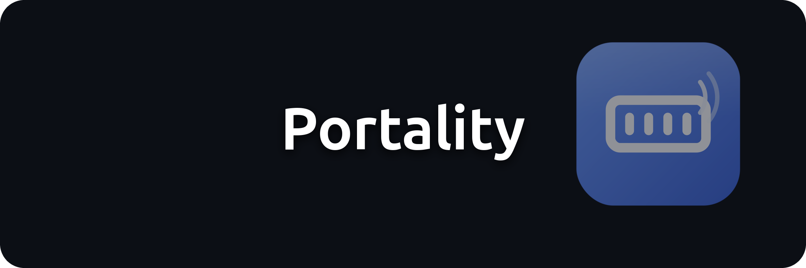

<div align="center">

<p align="center">
  
</p>

<p align="center"><b>English</b> | <a href="README.ja.md">日本語</a></p>

<h1 align="center">Portality</h1>

<h3 align="center">See every port and connection on your Windows PC.</h3>

<p align="center">A Windows desktop app for developers that lists TCP/UDP ports, per-connection traffic, and history. Built with Tauri (Rust) and React/TypeScript.</p>

<p align="center">
  <a href="https://github.com/Lapius7/portality/releases"></a>
  <a href="https://github.com/Lapius7/portality/actions/workflows/ci.yml"></a>
  <a href="LICENSE"></a>
  <a href="https://tauri.app"></a>
  <a href="https://www.microsoft.com/windows"></a>
  <a href="https://github.com/Lapius7/portality/stargazers"></a>
  <a href="https://github.com/Lapius7/portality/commits/main"></a>
</p>

<p align="center">
  <a href="#quick-start">Quick start</a> ·
  <a href="#features">Features</a> ·
  <a href="#development">Development</a> ·
  <a href="#roadmap">Roadmap</a>
</p>

</div>

---

## Features

- **Port list**: TCP/UDP connections via `GetExtendedTcpTable` / `GetExtendedUdpTable`, with the process name for each PID. Updated every second by diff polling and event push, in a virtualized table with search and filters.
- **Kill a process**: `TerminateProcess` with a confirmation dialog. On access denied, you can restart the app as administrator.
- **Traffic graphs**: per-connection EStats (`GetPerTcpConnectionEStats`) for TCP and adapter totals (`GetIfTable2`) for the whole system, shown as row sparklines and a chart in the detail panel. UDP is not supported because Windows has no equivalent per-connection counter.
- **History**: snapshots saved to SQLite (rusqlite, bundled) every 5 ticks of the poller. The history view has date-range and process-name filters, a timeline, CSV export, and automatic pruning by retention period.
- **Keyboard first**: a Cmd/Ctrl+K command palette for tab switching, connection search, and kill. Toasts report kill and CSV export results.
- **Tray**: closing the window keeps the app in the system tray.
- **Auto update**: `tauri-plugin-updater` checks `latest.json` on GitHub Releases, then downloads, installs, and restarts.

## Quick start

1. Download the latest `Portality_x.y.z_x64-setup.exe` from [Releases](https://github.com/Lapius7/portality/releases/latest).
2. Run the installer.
3. Start Portality from the Start menu or the desktop shortcut.

> [!NOTE]
> Windows SmartScreen may warn on first run because the installer has no code-signing certificate. Choose "More info", then "Run anyway".

**After you start it**

- Closing the window does not quit the app; it stays in the **system tray**. Click the tray icon, or choose "Open" in its right-click menu, to show it again.
- To quit completely, right-click the tray icon and choose "Quit".
- To make kill and traffic measurement more accurate, choose "Restart as administrator" on the Settings tab. It is not required.

**Update**: use Settings, Update, Check for updates in the app. It detects new GitHub releases, then downloads, installs, and restarts.

## Development

You need Node.js 18+, Rust (stable, MSVC toolchain), and the [Tauri prerequisites](https://tauri.app/start/prerequisites/) (WebView2 is included in Windows 11).

```powershell
pnpm install
pnpm run tauri dev      # start the dev server
pnpm run tauri build    # release build with an NSIS installer
```

The app and installer icon comes from `design/icon.svg`. To replace it, edit the SVG and run `npx tauri icon design/icon.svg` to regenerate every size under `src-tauri/icons/` and `icon.ico`.

<details>
<summary>Architecture</summary>

```
src-tauri/src/
├── net/              # TCP/UDP enumeration (Windows IP Helper API) + process info
├── process/kill.rs   # process termination
├── elevation.rs      # admin check and elevation
├── poller.rs         # background polling -> diff events, traffic, history writes
├── traffic/          # per-connection EStats + adapter-total fallback, rolling buffer
├── persistence/      # SQLite (rusqlite) history, filtered queries, retention pruning
├── tray.rs           # tray icon and menu (Open / Quit), stay resident on close
└── commands/         # Tauri commands called from the frontend

.github/workflows/
├── ci.yml            # build check on push/PR (frontend + Rust)
└── release.yml       # on a vX.Y.Z tag, build the signed installer and publish a GitHub Release

src/
├── store/        # Zustand: connectionsStore (live connections), trafficStore, uiStore (tab/filter/selection)
├── queries/      # TanStack Query: initial load of connections/history, traffic subscription, kill/elevate mutations
└── components/
    ├── layout/   # frameless window + custom title bar + sidebar (Connections / History / Settings)
    ├── grid/     # virtualized table + search/filter bar + row sparklines
    ├── detail/   # detail panel for the selected connection + traffic chart
    ├── kill/     # kill confirmation dialog
    ├── history/  # history view, timeline, date-range presets, CSV export
    ├── settings/ # update interval, retention period, privilege display
    └── common/   # command palette (Cmd/Ctrl+K), toasts
```

</details>

> [!NOTE]
> This code was written in a Linux container. `cargo check` / `cargo build` (non-Windows targets, using the mock paths in `net/iphlpapi.rs`, `traffic/estats.rs`, and `traffic/adapter.rs`) and the frontend build (`tsc` / `vite build`) were confirmed there. The Windows-only API code (`Win32_NetworkManagement_IpHelper`, `GetPerTcpConnectionEStats`, `GetIfTable2`, `TerminateProcess`) is verified by building on a Windows runner in GitHub Actions. If `traffic/estats.rs` fails to compile, check the struct and constant names in the docs.rs page for your `windows` crate version. This rewrite did not re-run any build.

## Roadmap

All planned phases are done: port list, kill, traffic graphs, history, UI polish, tray, and auto update.

## License

[MIT](LICENSE)
